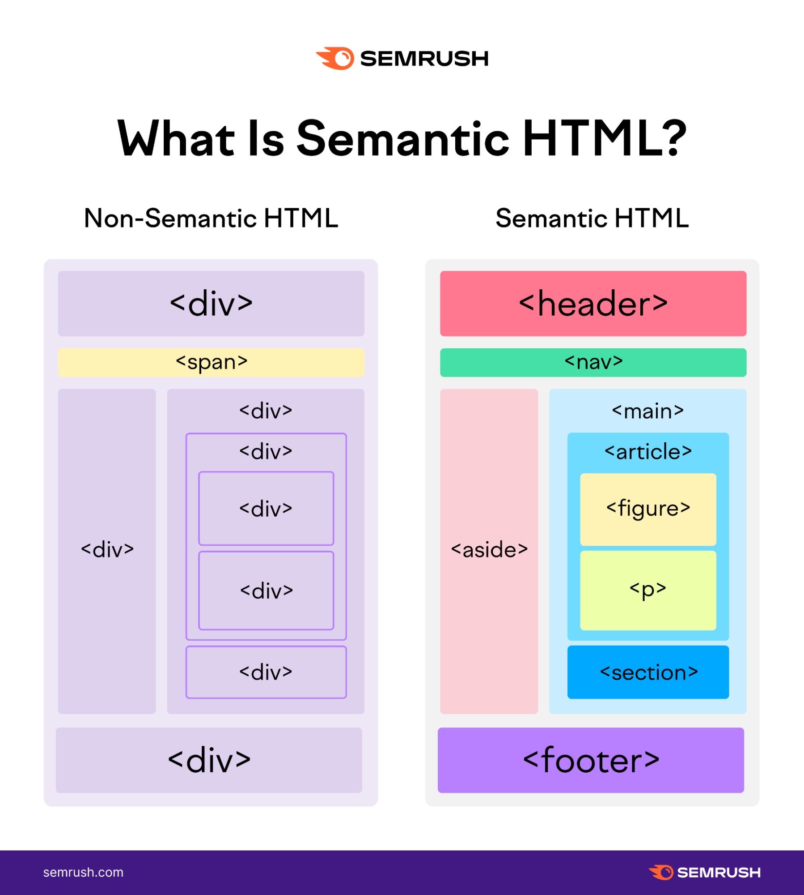

# Semantic HTML Tags

> HTML · Topic 6 · Demo: [index.html](index.html)

Semantic tags are used to define the structure of a page in a well-defined way: their names say what the content **is** (a header, the navigation, the main content, an article) instead of only how it is grouped. Browsers, screen readers and search engines all use that meaning. This note covers the layout elements and the landmarks they create, how to choose between `<article>`, `<section>` and `<div>`, and how to keep the semantics intact in a large codebase. (The demo `index.html` is empty; the diagram and the example page below serve as the demo.)

## Semantic vs non-semantic

- **Non-semantic** elements say nothing about their content: `<div>` and `<span>`. They are pure containers.
- **Semantic** elements describe their content: `<header>`, `<nav>`, `<main>`, `<article>`, `<section>`, `<aside>`, `<footer>`, `<figure>`, `<time>` and also older ones like `<h1>`, `<p>`, `<ul>`, `<table>`, `<form>`.



The diagram (image source: semrush.com) shows the same page layout built two ways. On the left, every region is a `<div>` (plus a `<span>`), so nothing tells a program which box is the menu or the main content. On the right, each region uses the element that matches its role: `<header>`, `<nav>`, `<aside>`, `<main>` containing an `<article>` (with a `<figure>` and a `<p>`) and a `<section>`, and finally `<footer>`.

Before HTML5, developers wrote `<div id="header">` or `<div class="nav">`. HTML5 turned those common patterns into real elements.

## Why semantic HTML matters

| Benefit | How |
|---------|-----|
| **Accessibility** | Screen readers expose `<header>`, `<nav>`, `<main>`, `<aside>` and `<footer>` as **landmarks**, so users can jump straight to "main" or "navigation" instead of listening to the whole page. |
| **SEO** | Search engines can identify the main content, the article text and the navigation more easily. |
| **Readable code** | `</article>` is easier to follow than the fifth `</div>` in a row. |
| **Browser features** | Reader mode, translation tools and browser extensions rely on the structure. |
| **Free behaviour** | Some semantic elements come with built-in behaviour, e.g. `<details>`/`<summary>` open and close, `<button>` is keyboard-focusable. |

> **Note:** Semantic layout elements have **no special styling**: `<header>`, `<nav>`, `<main>`, `<section>`, `<article>`, `<aside>` and `<footer>` are simply block elements that look exactly like a `<div>`. Their value is the meaning, not the look.

## The layout elements

| Element | Meaning | Landmark role (for screen readers) |
|---------|---------|------------------------------------|
| `<header>` | Introductory content: logo, site title, often the navigation. Can also be the header of an article or section. | `banner` when it is the page header (not inside `<article>`, `<section>`, `<aside>`, `<nav>` or `<main>`) |
| `<nav>` | A block of **major** navigation links (main menu, table of contents, pagination) | `navigation` |
| `<main>` | The dominant, unique content of the page | `main` |
| `<article>` | Self-contained content that would make sense on its own or if syndicated: a blog post, news story, product card, forum post, comment | `article` |
| `<section>` | A thematic group of content, normally with a heading: "Features", "Pricing", "Chapter 2" | `region`, only when it has an accessible name (e.g. `aria-labelledby`) |
| `<aside>` | Content indirectly related to the main content: sidebar, related links, ads, call-out box | `complementary` |
| `<footer>` | Footer of the page or of a section/article: copyright, contact, related links | `contentinfo` when it is the page footer |

### Other semantic elements

| Element | Meaning |
|---------|---------|
| `<figure>` + `<figcaption>` | Self-contained illustration, diagram, photo or code listing with its caption |
| `<time datetime="2024-05-01">` | A date/time in human form plus a machine-readable value |
| `<mark>` | Highlighted text (e.g. search matches) |
| `<address>` | Contact information for the page or article author |
| `<details>` + `<summary>` | A disclosure widget the user can open and close |
| `<strong>`, `<em>` | Strong importance, stress emphasis (vs. purely visual `<b>`, `<i>`) |

## A semantic page skeleton

This is the right-hand side of the diagram written as HTML:

```html
<body>
    <header>
        <h1>codeWithAman</h1>
    </header>

    <nav>
        <ul>
            <li><a href="/">Home</a></li>
            <li><a href="/blog">Blog</a></li>
            <li><a href="/about">About</a></li>
        </ul>
    </nav>

    <aside>
        <h2>Popular posts</h2>
        <ul>
            <li><a href="/blog/flexbox">Flexbox in 10 minutes</a></li>
        </ul>
    </aside>

    <main>
        <article>
            <h2>Learning Semantic HTML</h2>
            <p>Published <time datetime="2024-05-01">1 May 2024</time></p>
            <figure>
                
                <figcaption>A typical semantic layout.</figcaption>
            </figure>
            <p>Semantic tags describe the meaning of content...</p>
        </article>

        <section aria-labelledby="comments-title">
            <h2 id="comments-title">Comments</h2>
            <article>
                <p>Great explanation!</p>
                <footer>Posted by Riya</footer>
            </article>
        </section>
    </main>

    <footer>
        <p>&copy; 2024 codeWithAman</p>
    </footer>
</body>
```

## Choosing between `<article>`, `<section>` and `<div>`

Ask these questions in order:

1. **Would the content make sense on its own**, for example in an RSS feed or shared on another site? Use `<article>`.
2. **Is it a thematic part of something bigger** that deserves a heading (and would appear in a table of contents)? Use `<section>`.
3. **Is it only needed for styling or layout** (a wrapper for Flexbox, a grid cell)? Use `<div>`.

They nest freely: an `<article>` can be split into `<section>`s, and a `<section>` can contain several `<article>`s (like the comments above, or a list of blog-post cards).

## Rules to remember

- Use **one visible `<main>`** per page. Place it directly in `<body>` (or inside a plain wrapper `<div>`), never inside `<article>`, `<section>`, `<aside>`, `<header>`, `<footer>` or `<nav>`.
- `<header>` and `<footer>` **can appear many times**: one for the page and one inside each article or section. They cannot be nested inside another `<header>` or `<footer>`.
- Use `<nav>` for **major** navigation blocks only; a couple of links in a footer do not need one. If a page has several `<nav>`s, label them (`<nav aria-label="Breadcrumb">`).
- A `<section>` should normally start with a heading.
- `<aside>` is for content that could be removed without hurting the main content. Global sidebars sit outside `<main>` (as in the diagram); an aside about one article can sit inside that article.

## Common Mistakes

- **"Div soup"** — building the entire page from `<div>`s with class names like `header` and `nav`; the meaning is lost for assistive technology.
- **Using `<section>` as a generic wrapper** — if you only need a styling hook, use `<div>`.
- **Several visible `<main>` elements**, or a `<main>` nested inside an `<article>`.
- **Wrapping every group of links in `<nav>`** — too many navigation landmarks make them useless for navigation.
- **Expecting semantic tags to change the look** — they render like `<div>`; the layout comes from CSS.
- **Adding redundant ARIA**, such as `<nav role="navigation">` or `<main role="main">` — native elements already have these roles.
- **Choosing headings by size inside sections** — each section's heading level should reflect the outline.

## Key Takeaways

- Semantic elements describe what content is; `<div>` and `<span>` only group it.
- Page layout: `<header>`, `<nav>`, `<main>`, `<article>`, `<section>`, `<aside>`, `<footer>`.
- Landmarks let screen-reader users jump between regions, and help search engines find the main content.
- `<article>` = stands on its own; `<section>` = themed part with a heading; `<div>` = styling only.
- One visible `<main>` per page; `<header>`/`<footer>` may repeat inside articles and sections.
- Semantic tags carry no styling of their own; prefer native semantic elements over ARIA roles on `<div>`s.

## Interview Questions

### Junior (0–1 year)

**Q1. What are semantic HTML elements? Give examples.**
Elements whose name describes the meaning of their content, such as `<header>`, `<nav>`, `<main>`, `<article>`, `<section>`, `<aside>`, `<footer>`, `<figure>` and `<time>`. Non-semantic elements like `<div>` and `<span>` give no information about their content.

**Q2. Why should you use semantic tags instead of `<div>`s?**
They improve accessibility (screen readers expose them as landmarks for quick navigation), help search engines understand the page, make the code easier to read and maintain, and enable browser features like reader mode. They cost nothing extra.

**Q3. What is the difference between `<article>` and `<section>`?**
`<article>` is self-contained content that makes sense on its own, like a blog post, news story or comment. `<section>` is a thematic grouping of content within a page or article, normally introduced by a heading. A blog post is an `<article>`; its "Introduction" and "Conclusion" parts could be `<section>`s.

**Q4. Can a page have more than one `<header>` or `<footer>`?**
Yes. There is usually a page-level header and footer, and each `<article>` or `<section>` can have its own header (title, author, date) and footer (tags, comments link). Only the page-level ones become the `banner` and `contentinfo` landmarks.

**Q5. What kind of content goes in `<aside>`?**
Content that is related to the surrounding content only indirectly and could be removed without loss: sidebars, related posts, author bios, glossary boxes, advertisements.

**Q6. How many `<main>` elements can a page have?**
Only one visible `<main>`. It holds the dominant content unique to that page and sits directly in `<body>` (or a wrapper `<div>`), not inside `<article>`, `<section>`, `<aside>`, `<header>`, `<footer>` or `<nav>`. (Additional `<main>` elements are allowed only if all but one are `hidden`, as some single-page apps do.)

### Mid-level (2–4 years)

**Q7. What are landmarks, and which HTML elements create them?**
Landmarks are regions of a page that assistive technology lists so users can jump between them. `<header>` (page-level) maps to `banner`, `<nav>` to `navigation`, `<main>` to `main`, `<aside>` to `complementary`, `<footer>` (page-level) to `contentinfo`, `<form>` and `<section>` to `form`/`region` when they have an accessible name, and `<search>` to `search`. Using these native elements gives you landmarks without any ARIA.

**Q8. You inherit a page built entirely from `<div class="header">`, `<div class="menu">`, `<div class="content">`. How do you refactor it, and what must you watch out for?**
Replace each region with its semantic element (`<header>`, `<nav>`, `<main>`, `<article>`/`<section>`, `<aside>`, `<footer>`), keep the classes so existing CSS still applies, and check that selectors which target `div.header` are updated. Fix the heading outline at the same time, label multiple `<nav>`s with `aria-label`, then test with a screen reader's landmark list or the browser's accessibility tree.

**Q9. Does using semantic tags directly improve Google ranking?**
Not as a direct ranking factor on its own. It helps search engines parse the page: they can identify the main content, headings and navigation more reliably, and it supports good accessibility and user experience. Content quality matters far more, but semantic markup removes ambiguity and costs nothing.

**Q10. When would you use `role="navigation"` on a `<div>` instead of a `<nav>` element?**
Almost never. The first rule of ARIA is to use a native element with the built-in semantics whenever one exists. ARIA roles are for cases where you cannot change the element, such as markup generated by a third-party library. Adding `role="navigation"` to a `<nav>` is redundant.

**Q11. How would you mark up a blog post with its comments?**
Put the post in an `<article>` with a `<header>` (title, author, `<time datetime>`), the body text, and a `<footer>`. The comments go in a `<section>` with a heading such as "Comments", and each comment is its own nested `<article>`, because each one is a self-contained piece of content related to the post.

**Q12. A `<section>` element does not appear in the screen reader's landmarks list. Why?**
A `<section>` only becomes a `region` landmark when it has an accessible name, for example via `aria-labelledby` pointing to its heading or an `aria-label`. Without a name it is treated like a generic container, which prevents pages full of unlabelled sections from flooding the landmark list.

### Senior (5+ years)

**Q13. You own the layout components of a design system used by many teams. How do you design their API so teams produce correct semantics by default?**
Separate meaning from appearance in the API. A heading component takes a `level` (the element, `<h2>`) and a separate `size` (the look), so nobody picks `<h4>` because it "looks right". A layout box takes an `as` prop typed as a small union (`"div" | "section" | "article" | "aside" | "li"`) rather than any string, and defaults to `div`, because a generic element is never wrong while a wrong landmark is. A `<Section>` that should be a landmark requires a label (`aria-labelledby` wired to its heading by the component).

Landmarks that must appear once belong to one **page shell** component: the page `<header>`, a labelled `<nav>`, `<main id="main">` (the skip-link target) and `<footer>`. Feature teams render into the shell's slots and never output their own `<main>`; in micro-frontend setups the shell owns the `<h1>` rule too. Recommendation: make the correct element the default, make the wrong one hard to express in the types, and keep page-level landmarks in a single shell.

**Q14. QA reports that VoiceOver no longer announces "list, 6 items" for a product grid built with `<ul>`, and a "responsive" table is read as plain text. The HTML is semantic. What is going on?**
CSS can change what the browser exposes in the accessibility tree. Safari/WebKit deliberately drops list semantics from a `<ul>`/`<ol>` styled with `list-style: none` (lists inside `<nav>` are exempt), so the grid stops being a list. Changing `display` on table elements to `block`, `flex` or `grid` for a mobile layout has dropped table semantics in several browser versions. Older browsers also removed elements with `display: contents` from the tree (see [Display and visibility](../../02-css/06-display-and-visibility/notes.md)).

Debug it in the accessibility tree, not in the markup: the Chrome DevTools Accessibility pane (or its full-page tree view), the Safari Web Inspector node details, and a real screen reader on macOS and iOS. Fix it by restoring the role explicitly where the count or structure matters (`<ul role="list">`; `role="table"`, `row`, `columnheader` and `cell` on a restyled table) or by choosing a layout that keeps the native display. Recommendation: treat the accessibility tree as the contract, test Safari with VoiceOver for every list and table component, and add explicit roles only where CSS strips them.

**Q15. How do you stop semantic structure from regressing in a large codebase with many contributors?**
Automate the mechanical checks: `eslint-plugin-jsx-a11y` rules such as `no-redundant-roles` and `prefer-tag-over-role`, and axe-core in component and end-to-end tests with rules such as `landmark-one-main`, `region` (all content inside landmarks), `page-has-heading-one`, `heading-order` and `landmark-unique`, failing the build on new violations. Automated tools find only part of the problems: they cannot tell whether something should have been an `<article>` or whether a heading describes its section.

Cover the rest with people and structure: document do/don't examples in the design system, add a short semantics item to the pull-request checklist, and audit each **page template** (not every page) with a screen reader's landmark and heading lists. Track violations per template so the number only goes down. Recommendation: CI for what is mechanical, template-level manual reviews for judgement calls, and a shared page shell so most pages are correct by construction.

> **Note:** Related questions answered elsewhere: [Web Accessibility (a11y)](../11-accessibility/notes.md#interview-questions) (announcing SPA route changes).

## References
- [CodeWithHarry: HTML semantic tags](https://www.codewithharry.com/tutorial/html-semantic-tags/)
- [MDN: Semantics](https://developer.mozilla.org/en-US/docs/Glossary/Semantics)
- [MDN: `<main>`](https://developer.mozilla.org/en-US/docs/Web/HTML/Reference/Elements/main)
- [MDN: `<article>`](https://developer.mozilla.org/en-US/docs/Web/HTML/Reference/Elements/article)
- [MDN: `<section>`](https://developer.mozilla.org/en-US/docs/Web/HTML/Reference/Elements/section)
- [MDN: `<aside>`](https://developer.mozilla.org/en-US/docs/Web/HTML/Reference/Elements/aside)
