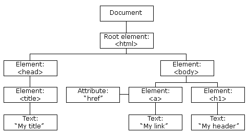
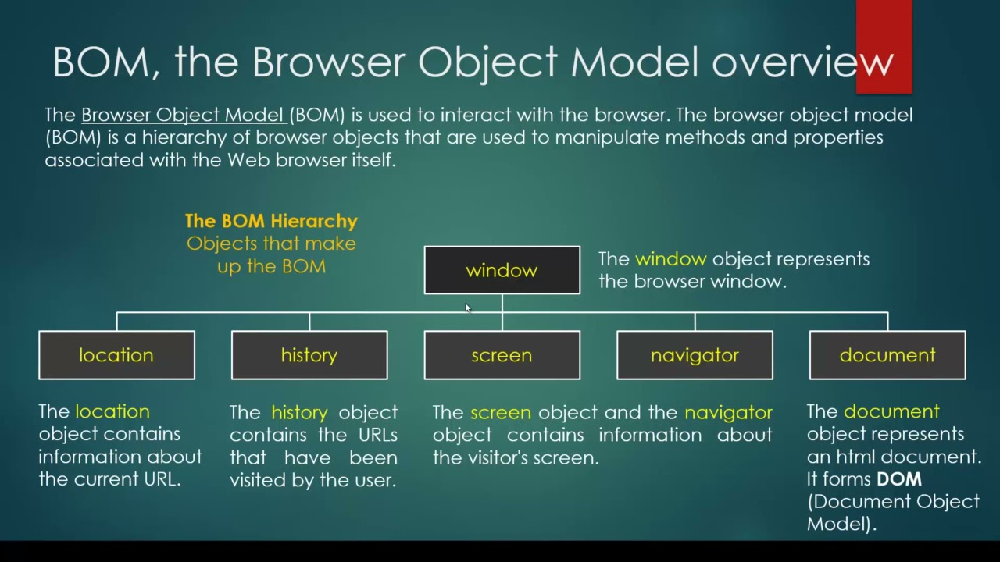

# DOM and BOM: Document Object Model and Browser Object Model

> JavaScript · Topic 20 · Demo: [index.html](index.html) · Open index.html in a browser: the inline script turns the `<h1>` red.

The **DOM** is the browser's live, object-based copy of an HTML page. JavaScript cannot work with HTML tags directly; it reads and changes this tree of objects, and the browser updates the screen to match. The **BOM** is the set of objects around the page (`window`, `location`, `history`, `navigator`, `screen`) that let JavaScript talk to the browser itself.

## What is the DOM?

DOM stands for **Document Object Model**. It is a programming interface (API) that lets us create, change, or remove elements in the document. We can also attach events to these elements to make the page dynamic.

- The DOM views an HTML document as a **tree of nodes**. Each node is an object that represents one part of the document.
- The DOM is a **cross-platform and language-independent** interface that treats an HTML or XML document as a tree structure in which each node is an object representing a part of the document. In the browser we use it from JavaScript, but the model itself is not tied to one language.
- The DOM represents the document as a **logical tree**: every node except the root `document` has exactly one parent, and a node can have any number of children.

> **Note:** The original notes said "a node represents an HTML element". That is only partly true. Elements are one kind of node. The text between tags, HTML comments and the `document` itself are also nodes. This difference matters a lot when you walk the tree (`childNodes` vs `children`, see [DOM tree navigation](../21-dom-tree-navigation/notes.md)).

### The three parts of the W3C DOM standard

| Part | What it covers |
|---|---|
| **Core DOM** | The standard model for all document types: nodes, the tree, basic methods like `appendChild()` |
| **XML DOM** | The standard model for XML documents |
| **HTML DOM** | The standard model for HTML documents: HTML elements as objects, and properties like `id`, `innerHTML`, `style` |

> **Note:** This three-way split comes from the old W3C specifications. Today the DOM is maintained by WHATWG as a "living standard" (the DOM Standard plus the HTML Standard). The split is still a good mental model and still comes up in interviews.

## HTML DOM

The HTML DOM is a standard object model and programming interface for HTML documents. It represents the web page in a structured, hierarchical way so that programmers (and tools) can move through the document easily.

With the HTML DOM we can access and change tags, IDs, classes, attributes and elements using the properties and methods of the `document` object. Through the DOM, JavaScript also reaches the CSS of the page (for example `element.style`) and can change how elements look and behave.

The HTML DOM defines:

- every HTML element as an **object**
- the **properties** of those objects (`id`, `className`, `innerHTML`, `style`, ...)
- the **methods** to reach and change them (`getElementById()`, `querySelector()`, `createElement()`, ...)
- the **events** they can fire (`click`, `input`, `submit`, ...)

### The DOM tree

Take this small page:

```html
<!DOCTYPE html>
<html>
  <head>
    <title>My title</title>
  </head>
  <body>
    <a href="#">My link</a>
    <h1>My header</h1>
  </body>
</html>
```

The browser turns it into this tree (hierarchy of the object model):



How to read the diagram:

- `document` is the top of the tree and the entry point for all DOM work.
- `<html>` is the **root element**. In JavaScript it is `document.documentElement`.
- `<head>` and `<body>` are **children** of `<html>` and **siblings** of each other.
- "My title", "My link" and "My header" are **text nodes**, children of their elements.
- `href` is an **attribute** of `<a>`. Attributes belong to the element (in `element.attributes`); they are not children in the tree.

You can explore the same structure in the devtools console of any page:

```js
document.documentElement;     // → <html>...</html>  (the root element)
document.head;                // → <head>...</head>
document.body;                // → <body>...</body>
document.title;               // → the text inside <title>
document.body.children.length // → number of element children of <body>
```

## Why is the DOM required?

HTML gives the page its structure and JavaScript adds behaviour. When an HTML file loads, JavaScript cannot understand the HTML text directly. The browser parses the HTML and builds the DOM from it, and JavaScript reads and changes that DOM.

So the DOM is the same HTML document, represented as a tree of objects. JavaScript cannot understand the tag `<h1>H</h1>`, but it can understand the `h1` **object** in the DOM.

This is exactly what the lecture demo does:

```html
<body>
  <h1 id="myH1">The Element Object</h1>
  <h2>The style Property</h2>

  <script>
    const h1 = document.getElementById("myH1"); // an HTMLHeadingElement object
    console.log(h1.textContent);                 // → "The Element Object"
    h1.style.color = "red";                      // change the object → the browser repaints the heading red
  </script>
</body>
```

What the DOM makes possible:

- **Dynamic web pages:** JavaScript can read and change page content, structure and style while the page is running, which gives interactive and responsive experiences.
- **Interactivity:** we can respond to user actions (clicks, inputs, scrolls) and change the page in response.
- **Content updates without a reload:** when only part of the page needs to change, the DOM lets us make a targeted change instead of refreshing the whole page. This makes web apps faster and more pleasant to use, and it is the foundation that libraries like React build on.

### How the browser builds the DOM and draws the page

1. The browser downloads the HTML and **parses** it from top to bottom into DOM nodes.
2. It parses the CSS into the **CSSOM** (CSS Object Model).
3. It combines DOM and CSSOM into a **render tree**, works out the size and position of every box (**layout**, also called reflow), then **paints** pixels.
4. When JavaScript changes the DOM or styles, the browser redoes the parts of step 3 that are affected.

The full pipeline (style, layout, paint, composite) and what each kind of change costs is covered in [The rendering pipeline](../../04-browser-platform/01-rendering-pipeline/notes.md).

Two consequences every beginner hits:

**1. A script can only see elements that were parsed before it.** A `<script>` runs as soon as the parser reaches it, so elements below it do not exist yet:

```html
<head>
  <script>
    console.log(document.getElementById("myH1")); // → null (the h1 has not been parsed yet)
  </script>
</head>
<body>
  <h1 id="myH1">Hi</h1>
</body>
```

That is why the demo puts its `<script>` at the end of `<body>`, after the `<h1>`. Other fixes (script placement, `defer` and `async` are covered in [How JavaScript runs](../01-how-js-runs/notes.md#where-do-i-put-the-script-in-html)):

```html
<!-- defer: download in parallel, run after the whole document is parsed -->
<script src="script.js" defer></script>
```

```js
// or wait for the DOMContentLoaded event
document.addEventListener("DOMContentLoaded", () => {
  document.getElementById("myH1").style.color = "red";
});
```

**2. The DOM is not the HTML source.** "View Page Source" shows the HTML file as downloaded. The devtools **Elements** panel shows the live DOM, which includes every change JavaScript has made and every fix the parser made to invalid HTML (for example, the parser inserts a `<tbody>` into a `<table>` written without one).

## BOM (Browser Object Model)

The Browser Object Model (BOM) is a collection of objects exposed by the browser that allow JavaScript to interact with the browser window, the document, and other browser-specific features. The BOM includes objects such as `window`, `navigator`, `location`, `history` and `screen`.

The **`window`** object is the entry point to the BOM and gives access to all the other objects in it.

In short, the BOM is a pack of objects that let us control the browser: access the browsing history, open a new window, get the current page address (URL), redirect the browser to a new page, and so on.



| Object | What it represents | Common uses |
|---|---|---|
| `window` | The browser window or tab. It is also the **global object** for browser JavaScript. | `alert()`, `setTimeout()`, `innerWidth`, `open()`, `scrollTo()` |
| `window.location` | The current URL | `location.href`, `location.reload()`, `location.assign(url)`, `location.replace(url)` |
| `window.history` | The session history of this tab | `history.back()`, `history.forward()`, `history.go(-2)`, `history.pushState()` |
| `window.screen` | The user's physical screen | `screen.width`, `screen.height`, `screen.availWidth` |
| `window.navigator` | The browser and the device | `navigator.userAgent`, `navigator.language`, `navigator.onLine`, `navigator.clipboard` |
| `window.document` | The loaded page, which is the DOM | `document.getElementById()`, `document.title` |

> **Note:** Two corrections to the slide in the image. First, only `screen` describes the visitor's screen; `navigator` describes the browser and device (user agent, language, online status, clipboard, geolocation). Second, `history` does hold the URLs visited in this tab, but for privacy reasons a script cannot read them. It can only read `history.length` and move back and forward.

```js
// Run these in the devtools console
console.log(location.href);      // → the full URL of the current page
console.log(location.hostname);  // → e.g. "developer.mozilla.org"
console.log(navigator.language); // → e.g. "en-US"
console.log(screen.width);       // → e.g. 1920
console.log(history.length);     // → number of entries in this tab's history
console.log(window.innerWidth);  // → width of the viewport in CSS pixels

// window is the global object, so the prefix is optional
console.log(window.document === document); // → true
console.log(window.alert === alert);       // → true

// Redirect the browser to another page
// location.href = "https://example.com";
```

### Globals and `window`

Because `window` is the global object, global `var` declarations and function declarations become properties of `window`. `let`, `const` and `class` do not.

```js
// in a classic (non-module) script or the console
var a = 1;
let b = 2;
function greet() {}

console.log(window.a);     // → 1
console.log(window.b);     // → undefined
console.log(window.greet); // → ƒ greet() {}
```

### DOM vs BOM

| | DOM | BOM |
|---|---|---|
| Represents | The content of the page | The browser around the page |
| Main object | `document` | `window` |
| Standard | WHATWG DOM Standard and HTML Standard | Never had one formal standard; most parts (`window`, `location`, `history`, `navigator`) are now defined in the HTML Standard |
| Examples | `getElementById()`, `createElement()`, `innerHTML` | `location`, `history`, `navigator`, `screen`, `setTimeout()`, `alert()` |
| Relationship | `document` is a property of `window` | `window` contains the DOM |

## Common Mistakes

- **Running DOM code before the element exists.** A script in `<head>` without `defer` gets `null` and then throws `TypeError: Cannot read properties of null`. Put scripts at the end of `<body>` or use `defer`.
- **Thinking every node is an element.** Whitespace between tags and comments are nodes too. Use element-only properties (`children`, `firstElementChild`) when you only want elements.
- **Expecting "View Page Source" to show JavaScript changes.** Use the Elements panel to see the live DOM.
- **Relying on IDs as global variables.** Browsers expose `<h1 id="myH1">` as `window.myH1`. This works but is fragile: any global variable with the same name hides it. Always select elements explicitly.
- **Creating accidental globals.** Global `var` declarations become `window` properties and can clash with built-ins such as `window.name` or `window.status`. Prefer `let`/`const`.

## Key Takeaways

- The DOM is a tree of objects that the browser builds from HTML; JavaScript works with that tree, not with the HTML text.
- Nodes include elements, text, comments and the document itself; elements are only one node type.
- `document` is the entry point to the DOM; `document.documentElement` is the `<html>` element.
- Changing the DOM makes the browser recalculate layout and repaint, which is how the page updates without a reload.
- Scripts can only see elements parsed before them: use end-of-body scripts, `defer`, or `DOMContentLoaded`.
- The BOM (`window`, `location`, `history`, `navigator`, `screen`) controls the browser; `window` is its root and also the global object.
- The DOM is part of the BOM's world: `window.document` is the DOM.

## Interview Questions

### Junior (0–1 year)

**Q1. What is the DOM?**
The Document Object Model is a programming interface that represents an HTML (or XML) document as a tree of objects called nodes. The browser builds it by parsing the HTML. JavaScript uses the DOM API (`document.getElementById`, `createElement`, `addEventListener`, ...) to read and change the content, structure and style of the page, and the browser re-renders to reflect the changes.

**Q2. Why can't JavaScript work with the HTML directly? Why do we need the DOM?**
HTML is just text. The browser parses that text into objects, and JavaScript is a language that works with objects, properties and methods. The DOM is the bridge: an `<h1>` tag becomes an `HTMLHeadingElement` object with properties like `textContent` and `style` that JavaScript can read and change.

**Q3. What is the difference between the DOM and the BOM?**
The DOM represents the page content and starts at `document`. The BOM represents the browser around the page and starts at `window`; it includes `location` (URL), `history` (back/forward), `navigator` (browser info), `screen` (display info), timers and dialogs like `alert()`. The DOM is reachable from the BOM as `window.document`.

**Q4. What is the `window` object?**
`window` represents the browser tab and is the global object for browser JavaScript. Every global function and BOM object hangs off it, which is why `alert()` and `window.alert()` are the same. Global `var` declarations and function declarations also become properties of `window`, while `let` and `const` do not.

**Q5. What is the difference between `document` and `document.documentElement`?**
`document` is the root node of the DOM tree (a `Document` object, `nodeType` 9). It is not an element. `document.documentElement` is the `<html>` element, the root **element** of the tree. `document.body` and `document.head` are shortcuts to `<body>` and `<head>`.

**Q6. How do you read the query string of the current URL, for example `?page=2&sort=name`?**
Use `location.search` together with `URLSearchParams`, which decodes the values for you:
```js
// URL: https://example.com/products?page=2&sort=name
const params = new URLSearchParams(location.search);
params.get("page");  // → "2" (always a string, or null if missing)
params.has("sort");  // → true
```
Avoid splitting the string by hand; it breaks on encoded characters (`%20`, `+`) and repeated keys (`params.getAll("tag")`). To build a URL, use `new URL(path, location.origin)` and `url.searchParams.set(...)`.

### Mid-level (2–4 years)

**Q7. Is the DOM the same as the HTML source? Give a case where they differ.**
No. The source is the text the server sent; the DOM is the live tree built from it and changed afterwards. They differ when JavaScript adds or removes nodes (a client-rendered React app has an almost empty source but a full DOM), and when the parser fixes invalid markup: for example it inserts `<tbody>` into a table written without one, or closes unclosed `<p>` tags. A CSS selector like `table > tr` then fails because the `tr` is really inside `tbody`.

**Q8. What does the browser do after you change the DOM, and why can DOM updates be slow?**
A change can invalidate style, layout (reflow) and paint. Layout is the expensive part because the position of one box can affect many others. The browser normally batches changes and re-renders once per frame, but if code reads a layout property (`offsetHeight`, `getBoundingClientRect()`) right after writing, the browser must do layout immediately. Doing write, read, write, read in a loop forces many layouts ("layout thrashing"). Batch the reads together and the writes together, and build large changes off-DOM (for example in a `DocumentFragment`) before inserting them once.

**Q9. What is the difference between `window.innerWidth`, `document.documentElement.clientWidth` and `screen.width`?**
`screen.width` is the whole physical display, which says nothing about the browser window. `window.innerWidth` is the viewport width **including** the vertical scrollbar. `document.documentElement.clientWidth` is the viewport width **without** the scrollbar, which is the width your layout actually gets and the one CSS media queries roughly match. For "is this a narrow layout?" checks, prefer `matchMedia("(max-width: 600px)").matches`, which uses exactly the same rules as your CSS breakpoints.

**Q10. What is the difference between the `DOMContentLoaded` and `load` events?**
`DOMContentLoaded` fires on `document` when the HTML is fully parsed and deferred scripts have run; images, stylesheets and iframes may still be loading. `load` fires on `window` after everything, including images, has loaded. Use `DOMContentLoaded` to attach listeners and query elements; use `load` only when you need final resources, such as image sizes.

**Q11. How does React's "virtual DOM" relate to the real DOM?**
The virtual DOM is a lightweight JavaScript description of what the UI should look like. On each update React builds a new description, compares it with the previous one (reconciliation), and applies only the differences to the real DOM. The real DOM is still what the browser renders; the virtual DOM is a strategy to minimise and batch real DOM operations while letting developers write UI as a function of state.

**Q12. What is the difference between `location.href = url`, `location.assign(url)` and `location.replace(url)`?**
Setting `location.href` and calling `location.assign(url)` both navigate and add a new entry to the history, so the Back button returns to the current page. `location.replace(url)` navigates while replacing the current history entry, so Back skips it. `replace` suits redirects such as "after login, go to the dashboard" where returning to the login page makes no sense.

### Senior (5+ years)

**Q13. Your app moves to server-side rendering and crashes with `ReferenceError: window is not defined`. How do you fix it properly, and how do you stop it recurring?**
On the server there is no BOM or DOM, so any `window`, `document`, `localStorage` or `navigator` access during module load or render throws. A `typeof window !== "undefined"` guard stops the crash but often causes a **hydration mismatch**: the server renders one thing, the client renders another (for example a layout chosen from `window.innerWidth`). The correct fix is to move browser-only reads into code that runs only on the client (an effect, an event handler, or a lazily loaded client-only component) and render a neutral default on the server, using CSS media queries rather than JavaScript when the choice is purely visual.

To stop it recurring, wrap BOM access in a small module (`getViewport()`, `storage.get()`) that is safe to import on the server and easy to mock in tests, and run the SSR build in CI. Recommendation: no top-level `window` access anywhere in shared code; browser APIs only behind client-only boundaries.

**Q14. Lighthouse reports "Avoid an excessive DOM size" on a dashboard with 40,000 nodes, and interactions feel slow. How do you approach it?**
DOM size multiplies the cost of everything: style recalculation, layout, memory, and every `querySelectorAll`. Lighthouse starts warning at around 800 body elements and flags pages above about 1,400, or deeper than 32 levels, or with a parent of more than 60 children. First measure where the time goes: the Performance panel shows long "Recalculate Style" and "Layout" entries, and the Interaction to Next Paint (INP) metric shows which interactions are slow.

Typical fixes, in order of payoff: virtualize long lists and tables (render only visible rows); render collapsed tabs, accordions and off-screen panels lazily instead of hiding them; add `content-visibility: auto` to large off-screen sections so the browser skips their rendering work; and remove wrapper `div`s that exist only for styling. Recommendation: set a DOM-size budget per page, check it in CI with Lighthouse, and treat any list that can grow without limit as a virtualization candidate from day one. See [Web performance](../../04-browser-platform/05-web-performance/notes.md).

**Q15. Third-party scripts (analytics, chat widget, A/B testing) run on your page. What can they do through `window` and the DOM, and how do you contain them?**
A classic script from another origin runs with the same rights as your own code: it can read every form field, change any element, read non-`HttpOnly` cookies and storage, overwrite globals such as `fetch` or `Array.prototype` methods, and slow the main thread. A conflict on a global name or a patched built-in is a common source of "only in production" bugs.

Containment, strongest first: run the widget in a sandboxed cross-origin `<iframe>` and talk to it with `postMessage`; restrict what may load and run with a Content Security Policy and pin file versions with Subresource Integrity (`integrity="sha384-..."`); load non-critical scripts after your own code and give them a performance budget; and keep an inventory of who owns each script. Recommendation: treat every third-party script as untrusted code with full page access, and prefer the iframe model for anything that does not need your DOM. See [Security: XSS, CSRF and CSP](../../04-browser-platform/04-security-xss-csrf-csp/notes.md).

**Q16. A teammate branches on `navigator.userAgent` to decide whether a feature works. What do you recommend instead?**
User-agent sniffing is brittle: browsers lie for compatibility (every Chromium browser contains "Safari"), Chrome has reduced and frozen most of the UA string for privacy, and a check written for today's versions silently breaks when a browser fixes the bug or adds the feature. Use **feature detection**: test for the API itself (`"IntersectionObserver" in window`, `typeof structuredClone === "function"`), for CSS support with `CSS.supports("display: grid")` or `@supports`, and for media features with `matchMedia`.

UA data is still acceptable for analytics, for logging, and for working around a confirmed bug in one browser version, ideally through User-Agent Client Hints on the server. Recommendation: feature detection by default; UA checks only for documented bug workarounds, each with a comment and a removal date.

> **Note:** Related questions answered elsewhere: [How JavaScript runs](../01-how-js-runs/notes.md#interview-questions) (`async` vs `defer` and where to put the script tag; a script in `<head>` gets `null` for elements below it).

## References
- [GeeksforGeeks: DOM (Document Object Model)](https://www.geeksforgeeks.org/dom-document-object-model/)
- [Medium: Browser Object Model (BOM), exploring the JavaScript window](https://medium.com/@stheodorejohn/browser-object-model-bom-exploring-the-javascript-window-fcaeea76b1b4#:~:text=The%20Browser%20Object%20Model%20(BOM)%20is%20a%20collection%20of%20objects,Location%2C%20History%2C%20and%20Screen.)
- [ADMEC: Browser Object Model in JavaScript](https://www.admecindia.co.in/web-design/browser-object-model-javascript/)
- [MDN: Document Object Model (DOM)](https://developer.mozilla.org/en-US/docs/Web/API/Document_Object_Model)
- [MDN: Window](https://developer.mozilla.org/en-US/docs/Web/API/Window)
- [MDN: DOMContentLoaded event](https://developer.mozilla.org/en-US/docs/Web/API/Document/DOMContentLoaded_event)
- [MDN: URLSearchParams](https://developer.mozilla.org/en-US/docs/Web/API/URLSearchParams)
- [MDN: Browser detection using the user agent](https://developer.mozilla.org/en-US/docs/Web/HTTP/Browser_detection_using_the_user_agent)
- [Chrome for Developers: Avoid an excessive DOM size](https://developer.chrome.com/docs/lighthouse/performance/dom-size)
