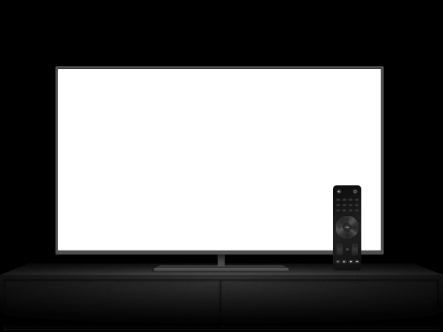

# Netflix Clone (HTML and CSS)

> Project · Topic 1 · Demo: [index.html](index.html) · [style.css](style.css)

A static copy of the Netflix India sign-up landing page, built with only HTML and CSS (no JavaScript). It practises the layout skills from the CSS section ([Flexbox](../../02-css/13-flexbox/notes.md), [Position and z-index](../../02-css/11-position-and-z-index/notes.md), [Media and container queries](../../02-css/15-media-and-container-queries/notes.md)) on a real design: Flexbox rows and columns, a hero section with a dark overlay, videos playing *inside* device images using absolute positioning, and a single media query that rearranges everything for phones.

## What the Page Contains

| # | Section | What you see | Main technique |
|---|---|---|---|
| 1 | Hero (`.header-and-background`) | Logo, language button, "Sign in", big heading, email box + "Get Started" | Background image, overlay `div`, Flexbox, `z-index` |
| 2 | "Enjoy on your TV" (`.content-with-video-on-tv`) | Text on the left, TV image with a video playing in its screen | `position: relative` parent + `position: absolute` video |
| 3 | "Download your shows to watch offline" (`.Second`) | Phone background with a "Stranger Things, Downloading..." card | Background image, Flexbox card, `:nth-child()` |
| 4 | "Watch everywhere" (`.page-3_content`) | Device pile image with a video inside the screen | Absolute positioning + `z-index` |
| 5 | "Create profiles for kids" (`.fourth`) | Image + text | Percentage widths, `column-reverse` on mobile |
| 6 | FAQ (`.FAQ-Section`) | Six question bars with a plus icon, second email form | Flexbox column, `<button>` rows |
| 7 | Footer (`footer`) | Phone number, 15 links in columns, language button | `inline-flex` + `flex-wrap` |

Each section is separated by an 8px grey band (`.seperator`).

## Project Structure

```text
01-netflix-clone/
├── index.html          the whole page
├── style.css           all styles + one mobile media query
├── notes.md            this file
└── Resources/
    ├── Images/
    │   ├── BackGround.jpg            hero background
    │   ├── Mobile_BackGround.jpg     phone image for section 3
    │   ├── boxshot-stranger.png      poster in the download card
    │   ├── download-icon.gif         animated download icon
    │   ├── favicon.ico
    │   ├── Page-3_device-pile-in.png
    │   ├── page_4-image.png
    │   └── tv-with_remote.png
    └── Videos/
        ├── Page-3_scared_game.m4v
        └── video_for_tv-with-remote.m4v
```

## How to Open It

1. Open `index.html` in a browser (double-click it), or right-click it in VS Code and choose **Open with Live Server**.
2. No install or build step is needed. Resize the window below 600px wide (or use the device toolbar in DevTools) to see the mobile layout.

> **Note:** The files used to be called `Index.html` and `Style.css`, while the page linked `href="style.css"`. Windows ignores filename case, so it worked locally, but on a case-sensitive host (GitHub Pages, Linux servers) the page loaded with **no styles**. Renaming both files to lowercase fixed it. The lesson still applies to every other path: `Resources/Images/BackGround.jpg` must be written with exactly that casing.

## Techniques Used

### 1. CSS reset and a Google Font

```css
@import url('https://fonts.googleapis.com/css2?family=Roboto:ital,wght@0,100;...&display=swap');

* {
  margin: 0;
  padding: 0;
  font-family: "Roboto", sans-serif;
}
```

The universal selector removes the browser's default margins and padding so spacing is fully under your control. `display=swap` shows fallback text immediately and swaps in Roboto when it loads.

> **Note:** `@import` inside CSS makes the browser download the font CSS only after `style.css` has arrived. A `<link>` tag in the HTML `<head>` (with `rel="preconnect"` to the font server) starts the download sooner.

### 2. Hero background with a dark overlay

```css
.header-and-background {
  background-image: url("./Resources/Images/BackGround.jpg");
  height: 98vh;
  position: relative;               /* the overlay is positioned against this box */
  background-position: center center; /* stays centred when the window is resized */
  background-repeat: no-repeat;
}

.opacity {                          /* an empty div that darkens the image */
  position: absolute;
  top: 0;
  height: 100%;
  width: 100%;
  background-color: black;
  opacity: 0.7;
}

.content-center {
  position: relative;
  z-index: 10;                      /* lift the text above the overlay */
}
```

The overlay is an absolutely positioned `div` stretched over the hero. The logo, the nav buttons and the centred content each get `position: relative; z-index: 10` so they sit **above** it. Without that, the dark layer would cover the text too.

A shorter alternative, with no extra element, layers a semi-transparent gradient on top of the image in a single `background` declaration:

```css
.header-and-background {
  background:
    linear-gradient(rgba(0, 0, 0, 0.7), rgba(0, 0, 0, 0.7)),
    url("./Resources/Images/BackGround.jpg") center / cover no-repeat;
}
```

`background-size: cover` (the `/ cover` part) scales the image to always fill the box; the clone does not set it, so the image shows at its natural size.

### 3. Flexbox navbar with inline SVG icons

```css
nav {
  display: flex;
  align-items: center;
  justify-content: space-between;  /* logo on the left, buttons on the right */
  width: 80vw;
  margin: auto;                    /* centre the nav */
}
nav .buttons {
  display: flex;
  gap: 2em;
}
```

The Netflix logo and the language/arrow icons are **inline SVG** copied into the HTML. The logo uses `fill="red"`. The icons use `fill="currentColor"`, so they automatically take the text colour of the button they sit in, and `aria-hidden="true"`, so screen readers skip them because the button text already says what they mean.

### 4. Units: `vh`, `em`, `rem` and `calc()`

| Unit | Relative to | Used for |
|---|---|---|
| `vh` / `vw` | 1% of the viewport height / width | Section heights (`85vh`), input width (`25vw`) |
| `rem` | The root (`<html>`) font size, 16px by default | Header padding (`2rem`) |
| `em` | The element's own font size (for `font-size` itself, the parent's) | Button padding, gaps |
| `px` | Fixed pixels | Borders, video offsets |

The CSS comments say "1 rem = 16 pixels" and "1 em = 16 px". That is true only with the default 16px font size; `em` changes whenever the element's font size changes.

`.content-center` uses `height: calc(95vh - 30vh);`, which is simply `65vh`. `calc()` becomes really useful when mixing units, for example `calc(100vh - 80px)` for "full height minus a fixed header".

> **Note:** On mobile browsers, `100vh` includes the area behind the address bar, so a "full height" section can be cut off. The newer `dvh` (dynamic viewport height) and `svh` (small viewport height) units fix this.

### 5. Email form row

```css
.Email-GetStart { display: flex; gap: 10px; }
.input-email {
  background: transparent;
  border: 2px solid rgb(75, 74, 74);
  color: white;
  width: 25vw;
  height: 50px;
}
.input-email:focus { outline-color: white; } /* keep the focus outline, just recolour it */
.input-Submit:hover { filter: opacity(0.6); }
```

The CSS comment mentions `outline-style: none` to "remove that yellow outline". Do not remove the focus outline without a replacement: keyboard users rely on it to see where they are. Recolouring it, as the clone does, is the right choice; `:focus-visible` lets you show it only for keyboard focus.

### 6. A video playing inside a TV image

```css
.tv-image { position: relative; }              /* positioning context */
.tv-image img { position: relative; width: 555px; }
.tv-image video {
  position: absolute;                          /* placed relative to .tv-image */
  width: 404px;
  top: 87px;
  right: 76px;                                 /* lines the video up with the TV screen */
  z-index: -10;                                /* behind the TV frame image */
}
```

```html
<div class="tv-image">
  
  <video src="Resources/Videos/video_for_tv-with-remote.m4v" autoplay loop muted></video>
</div>
```

The TV PNG has a transparent screen. The video is placed behind it (`z-index: -10`) at the exact pixel offset of the screen, so it looks like it is playing on the TV. Section 4 does the same with the device pile, but the other way round: the image gets `z-index: 10` and the video keeps the default.

- `autoplay loop muted`: browsers block autoplay **with sound**, so `muted` is required for `autoplay` to work. On iPhones, also add `playsinline` so the video does not open full screen.
- The pixel offsets only fit one image size, so the media query has to set new values (`top: 56px; right: 51px;`) for the smaller TV. Percentage offsets would scale automatically.

> **Note:** A negative `z-index` puts the element behind its nearest **stacking context**. Here `.tv-image` has no `z-index` of its own, so the video goes behind the whole section. It is visible only because the section has no background colour. Give the section a background and the video disappears. Setting `z-index: 0` (or `isolation: isolate`) on `.tv-image` keeps the video inside that box's own stack.

### 7. The download card and `:nth-child()`

```css
.download-with-stranger {
  display: flex;
  justify-content: space-around;
  align-items: center;
  border: 2px solid rgb(75, 74, 74);
  border-radius: 10px;
}
.stranger-text :nth-child(1) { color: white; font-size: 16px; } /* "Stranger things" */
.stranger-text :nth-child(2) { color: blue;  font-size: 14px; } /* "Downloading..." */
```

`:nth-child(n)` selects an element by its position among its siblings, so no extra classes are needed.

> **Note:** The space in `.download-with-stranger :nth-child(1)` is a **descendant** combinator: it matches *any* element inside the card that is a first child, including the "Stranger things" text `div`, not only the poster image. Use the child combinator to match only direct children: `.download-with-stranger > :nth-child(1)`.

### 8. Alternating layouts, reordered on mobile

Sections 2 to 5 are Flexbox rows (`.content-with-video-on-tv`). On phones they switch to columns, and sections 3 and 5 use `flex-direction: column-reverse` so the image appears in a sensible position without changing the HTML. This changes only the **visual** order; screen readers and the Tab key still follow the HTML order, so keep interactive content in a logical source order.

### 9. FAQ bars

Each question is a `<button>` styled as a full-width bar (`display: flex; justify-content: space-between;`) with a plus SVG on the right. In this clone the questions do not open: there is no answer content and no JavaScript. See [Accessible FAQ Accordion](../02-faq-accordion/notes.md) for how to make them work with `<details>`/`<summary>` or with a button and `aria-expanded`.

### 10. Footer columns with `inline-flex` and `flex-wrap`

```css
.footer-Ul { display: flex; justify-content: center; }
.footer-Ul ul {
  list-style: none;
  display: inline-flex;
  flex-wrap: wrap;            /* items move to the next line when the row is full */
}
.footer-Ul li { width: 23%; } /* about 4 links per row (43% → 2 per row on mobile) */
```

`display: flex` makes the container a **block-level** box (full width, starts on a new line). `display: inline-flex` makes it an **inline-level** box that is only as wide as its content and can sit next to other inline content. The children are laid out exactly the same way in both. The CSS links to [this GeeksforGeeks article](https://www.geeksforgeeks.org/what-is-the-difference-between-displayinline-flex-and-displayflex-in-css/) for the difference; [Display and visibility](../../02-css/06-display-and-visibility/notes.md) covers outer and inner display types in full.

A modern alternative for a link grid is CSS Grid: `display: grid; grid-template-columns: repeat(auto-fill, minmax(180px, 1fr));`, which picks the number of columns automatically.

### 11. Responsive design with one media query

```css
@media screen and (max-width: 599px) {
  .header-and-background { height: 60vh; }
  .Email-GetStart { flex-direction: column; align-items: center; }
  .input-email { width: 75vw; }
  .content-with-video-on-tv { flex-direction: column; height: 60vh; }
  .tv-image img { width: 350px; }
  .tv-image video { width: 250px; top: 56px; right: 51px; }
  /* ...smaller fonts, full-width FAQ bars, 2-column footer */
}
```

This is **desktop-first** design: the main CSS is for large screens, and the `max-width` media query overrides it for screens up to 599px wide. The opposite, mobile-first approach writes the phone layout first and adds `min-width` media queries for bigger screens.

## Favicon Tip

A favicon is the small icon shown in the browser tab. Add it inside `<head>`:

```html
<head>
  <link rel="shortcut icon" type="image/x-icon" href="favicon.ico" />
</head>
```

If you want to see the favicon of any website, just open `www.url.com/favicon.ico` (for example, the site's address followed by `/favicon.ico`).

More detail:

- The standard value is `rel="icon"`. `"shortcut icon"` is an old form that browsers still accept (`shortcut` is simply ignored).
- If a page has no icon `<link>`, browsers request `/favicon.ico` from the site root automatically. That is why the `/favicon.ico` trick works on many sites. Sites that keep their icon somewhere else (named in a `<link rel="icon">` tag) may return a 404 there; check the page source instead.
- A modern set covers more devices:

```html
<link rel="icon" href="/favicon.ico" sizes="any">
<link rel="icon" href="/icon.svg" type="image/svg+xml">
<link rel="apple-touch-icon" href="/apple-touch-icon.png">
```

> **Note:** This clone uses `rel="shortcut-icon"` (with a hyphen). That is a single unknown keyword, not "shortcut" + "icon", so the browser ignores the link and **no favicon appears**. The fix is `<link rel="icon" href="Resources/Images/favicon.ico" type="image/x-icon">`.

## Common Mistakes

Issues in this clone, kept here as a to-do list (the code itself is unchanged):

| Problem | Why it matters | Fix |
|---|---|---|
| `rel="shortcut-icon"` | Not a valid link type; no favicon | `rel="icon"` |
| ~~`href="style.css"` but the file is `Style.css`~~ **Fixed** by renaming the files to lowercase | Styles broke on case-sensitive hosts | Match the case exactly in every path |
| `<button class="btn btn-signin">Sign in</Watch anywhere. Cancel anytime.button>` | Broken closing tag (a paste accident); it works only because the browser repairs it | `</button>` |
| Email `<input>` with empty `name=""`/`id=""`, no `<label>`, no `<form>` | Screen readers announce no label; "Get Started" submits nothing | Wrap in `<form>`, add a (visually hidden) `<label for>`, `name="email"`, `autocomplete="email"` |
| `alt` attribute on `<svg>`, `aria-labelledby` pointing to IDs that do not exist | Invalid markup copied from the real site | Use `aria-hidden="true"` on decorative SVGs |
| FAQ buttons without answers or `aria-expanded` | Users cannot open them | Build an accordion |
| Footer links with `href=""` | Clicking reloads the page | Use real URLs or `#section-id` |
| Uppercase tags `<Header>`, `<H1>` | Work (HTML tag names are case-insensitive) but are unconventional | Use lowercase |
| Descendant `:nth-child` selectors | Style unintended nested elements | Use `>` |

## Key Takeaways

- A positioned parent (`position: relative`) plus an absolutely positioned child is how you layer elements, such as a video inside a device frame or an overlay on an image.
- `z-index` only works on positioned elements and is resolved inside a stacking context; negative values can hide an element behind its ancestors' backgrounds.
- An overlay can be an extra `div`, a pseudo-element, or a `linear-gradient` layered in `background`.
- `autoplay` videos must be `muted`; add `playsinline` for iOS.
- `display: flex` vs `inline-flex` only changes how the **container** behaves outside; Flexbox with `flex-wrap` (or Grid) builds column layouts.
- A desktop-first site uses `max-width` media queries to override styles for small screens; pixel-based positions need retuning at every breakpoint.
- Filenames and paths are case-sensitive on most servers; favicons need `rel="icon"`.

## Interview Questions

### Junior (0–1 year)

**Q1. How do you add a favicon to a web page?**
Put `<link rel="icon" href="favicon.ico">` inside `<head>` (you can add `type` and `sizes`, and an SVG or `apple-touch-icon` version for other devices). Older code writes `rel="shortcut icon"`, which still works. If there is no link, browsers try `/favicon.ico` at the site root.

**Q2. What is the difference between `position: relative` and `position: absolute`?**
`relative` keeps the element in the normal flow and lets you nudge it with `top`/`left` without affecting other elements; it also makes the element the positioning context for absolute children. `absolute` removes the element from the flow and positions it against the nearest positioned ancestor. The clone uses a relative `.tv-image` and an absolute `<video>` to line the video up with the TV screen.

**Q3. Why do the videos have the `muted` attribute?**
Browsers block autoplaying video that has sound, to protect users. A video with `autoplay` only starts on its own if it is `muted` (or the user has interacted with the site). `loop` restarts it at the end, and on iOS `playsinline` keeps it inside the page instead of going full screen.

**Q4. What is the difference between `em`, `rem` and `vh`?**
`rem` is relative to the root element's font size (16px by default), so it is consistent across the page. `em` is relative to the current element's font size, so it compounds when nested. `vh` is 1% of the viewport height, useful for full-screen sections.

**Q5. What does `@media screen and (max-width: 599px)` mean?**
The rules inside apply only on screens whose viewport is 599px wide or less. It is used here to override the desktop styles for phones: stacking flex rows into columns, shrinking fonts and images, and resizing the videos.

### Mid-level (2–4 years)

**Q6. The TV video uses `z-index: -10`. When would it disappear, and how do you make it safe?**
A negative `z-index` puts the element behind other content of its nearest stacking context. `.tv-image` does not create one (it has `position: relative` but no `z-index`), so the video is painted behind its ancestors' content; any ancestor background between it and the root would cover it. Make the parent a stacking context (`z-index: 0` or `isolation: isolate`) so the video stays behind only the TV image, or give the image a positive `z-index` and leave the video at `auto`, as section 4 does.

**Q7. Compare three ways to darken a hero background image.**
An extra overlay `div` (as here) is easy to understand but adds non-semantic markup and needs `z-index` on the content. A `::before` pseudo-element does the same without extra HTML. A `linear-gradient(rgba(...), rgba(...))` layered before the `url()` in `background` needs no extra element and no `z-index` at all, which makes it the simplest option in most cases.

**Q8. The site looks right locally, but on GitHub Pages it has no styles. How do you debug it?**
Open DevTools → Network and look for a 404 on the stylesheet. That is exactly what happened to this clone before its files were renamed: `Index.html` requested `style.css`, but the file was `Style.css`. Windows ignores the difference; GitHub Pages (Linux) does not. Fix the case in either the file name or the `href`, and check the other asset paths (`Resources/Images/...`) the same way.

**Q9. How would you refactor this CSS to mobile-first?**
Move the phone styles from the `max-width: 599px` block into the base CSS (single column, full-width inputs, smaller type), then add `@media (min-width: 600px)` (and larger breakpoints if needed) for the side-by-side layouts. Replace fixed pixel widths and offsets with percentages, `max-width`, `clamp()` font sizes and `aspect-ratio`, so fewer overrides are needed. Mobile-first usually means less CSS for phones to download and override.

**Q10. What is the difference between `.card :nth-child(1)` and `.card > :nth-child(1)`?**
With a space (descendant combinator), the selector matches every element at **any depth** inside `.card` that is the first child of its own parent. With `>` (child combinator), it matches only `.card`'s direct first child. The clone's download card accidentally styles the nested text `div` because of this.

**Q11. Audit the email capture form for accessibility. What would you change?**
Wrap the input and button in a `<form>` so Enter submits it and the button has something to submit. Add a `<label for="email">` (it can be visually hidden) because the placeholder disappears and is not a reliable label. Give the input `name="email"`, `autocomplete="email"` and `required`, keep a visible focus style, and check the contrast of the grey border and placeholder text against the dark background.

**Q12. Why can `height: 98vh` misbehave on phones, and what is the modern fix?**
On mobile browsers, `vh` is based on the largest viewport (with the address bar hidden), so content sized with `vh` can be taller than the visible area and get cut off when the bar is showing. Use `svh` (smallest viewport) when everything must fit, or `dvh` (dynamic, updates as the bars show and hide), with `vh` as a fallback for older browsers.

### Senior (5+ years)

**Q13. On a mid-range phone this page's LCP is over 4 seconds and it downloads two videos nobody may watch. How would you set a budget and fix it?**
Measure first with field data (CrUX or your own RUM), then a throttled Lighthouse run to see what the LCP element is. Here it is the hero background image, which is discovered late because it lives in CSS behind a render-blocking `@import`. The fixes, in order of payoff:

- Make the hero image discoverable early: `<link rel="preload" as="image" fetchpriority="high">` with `imagesrcset`, or render it as an `` with `fetchpriority="high"` and `object-fit: cover` instead of a CSS background. Serve AVIF/WebP at several widths; a 1920px JPEG on a 360px phone is wasted bytes.
- Replace the font `@import` with `<link rel="preconnect">` plus a `<link rel="stylesheet">` in `<head>`, or self-host the font.
- Do not download the below-the-fold videos up front: give them a `poster`, `preload="none"`, and attach the source when an `IntersectionObserver` sees them. Skip autoplay entirely when `prefers-reduced-motion: reduce` or the Save-Data header is set.

Recommendation: agree a budget per page type (for example LCP under 2.5 s at the 75th percentile on mobile, under 200 KB of critical-path bytes), check it in CI with Lighthouse CI, and treat the hero image as the one asset that gets priority; everything decorative loads late.

**Q14. The video-in-a-TV effect depends on pixel offsets that need retuning at every breakpoint. How would you rebuild it, and when would you not bother?**
Make the frame and the screen scale together. Give the wrapper `position: relative`, a fluid width (`width: min(555px, 100%)`) and an `aspect-ratio` that matches the PNG; make the image `width: 100%`. Then position the video with **percentages** of the frame, measured once from the image (`left: 13%; top: 15%; width: 73%; height: 58%`), plus `object-fit: cover`. Percentages of `left`/`width` resolve against the wrapper's width and `top`/`height` against its height, so the screen stays aligned at every size and the media query no longer needs `top: 56px; right: 51px`.

```css
.tv-image {
  position: relative;
  isolation: isolate;                            /* keeps z-index: -1 inside this box (see Q6) */
  width: min(555px, 100%);
  aspect-ratio: 555 / 416;                       /* the PNG's own width / height */
}
.tv-image img { width: 100%; height: 100%; }
.tv-image video {
  position: absolute;
  left: 13%; top: 15%; width: 73%; height: 58%;  /* example values: measure from your image */
  object-fit: cover;
  z-index: -1;
}
```

The alternative is to bake the device frame into the video itself during export. That is the most robust option (no alignment code at all) but costs file size and makes the frame impossible to restyle. Recommendation: use percentage positioning when the frame is reused or themed; use a pre-composited video when it is a one-off marketing asset and design owns the export.

**Q15. This clone broke on GitHub Pages because of filename case. How would you stop this class of bug from reaching production on a team?**
Make the CI environment match production: build and run a smoke test on Linux, where `Style.css` and `style.css` are different files. Add a link checker (for example a crawler that fails on any 404 for same-origin assets) or a Playwright test that loads each page and asserts no failed requests. Agree a naming convention, lowercase kebab-case for every file and folder, and enforce it with a lint rule or a short CI script. On Windows and macOS, `git config core.ignorecase false` makes renames that only change case visible to Git; otherwise a rename from `Style.css` to `style.css` can silently not be committed.

Recommendation: convention plus an automated check in CI. Code review alone does not catch it, because the bug is invisible on the reviewer's machine.

**Q16. Product wants to turn this static page into the real sign-up landing page, maintained by three teams. What would you change about the code structure before anything else?**
Split the page into components with clear owners (hero, feature row, FAQ, footer) and give each its own scoped styles: BEM, CSS Modules or `@layer` per component, so a change in one section cannot restyle another. The current global selectors (`.Second`, `.fourth`, `h1`, descendant `:nth-child`) collide easily. Pull colours, spacing and type sizes into custom properties (design tokens) so the brand can be changed in one place. Make the feature row one reusable component with an `image-side` option instead of four near-copies, fix the semantic HTML (one `<h1>`, a real `<form>`, a footer `<nav>`) and replace the dead FAQ buttons with a real [accordion](../02-faq-accordion/notes.md).

Recommendation: componentise and tokenise first, because it is what lets several teams work in parallel without regressions; performance and accessibility fixes then land once per component instead of once per section. See [CSS architecture](../../02-css/21-css-architecture/notes.md) for the scoping options.

> **Note:** Related questions answered elsewhere: [Display and visibility](../../02-css/06-display-and-visibility/notes.md#interview-questions) (`display: flex` vs `display: inline-flex`).

## References

- [GeeksforGeeks: Difference between display:inline-flex and display:flex](https://www.geeksforgeeks.org/what-is-the-difference-between-displayinline-flex-and-displayflex-in-css/)
- [MDN: rel attribute (link types)](https://developer.mozilla.org/en-US/docs/Web/HTML/Attributes/rel)
- [MDN: video element](https://developer.mozilla.org/en-US/docs/Web/HTML/Element/video)
- [MDN: position](https://developer.mozilla.org/en-US/docs/Web/CSS/position)
- [MDN: z-index](https://developer.mozilla.org/en-US/docs/Web/CSS/z-index)
- [MDN: calc()](https://developer.mozilla.org/en-US/docs/Web/CSS/calc)
- [MDN: @media](https://developer.mozilla.org/en-US/docs/Web/CSS/@media)
